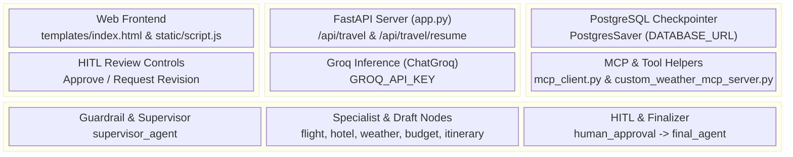
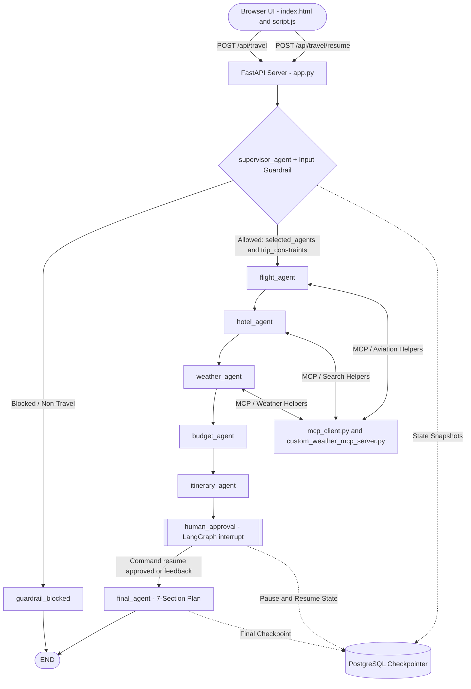

# TripCrew-AI — Production Multi-Agent Travel Orchestration System

[](https://www.python.org/)
[](https://www.langchain.com/langgraph)
[](https://fastapi.tiangolo.com/)
[](https://groq.com/)
[](https://modelcontextprotocol.io/)
[](https://www.postgresql.org/)
[](LICENSE)

**TripCrew-AI** is a stateful multi-agent travel planning application built with **FastAPI**, **LangGraph**, **Groq**, **PostgreSQL**, and **Model Context Protocol (MCP)** integrations. Developed across three progressive releases—**Part 1 (`v1.0-part1-MultiAgent_Workflow_Baseline`)**, **Part 2 (`v2.0-part2-MultiAgent_MCP_Integration`)**, and **Part 3 (`v3.0-part3-Supervisor_Guardrails_Safety_HITL`)**—it combines input guardrails, supervisor-driven agent routing and trip constraint extraction, MCP-backed specialist tools, durable PostgreSQL state checkpointing, and Human-in-the-Loop (HITL) plan approval and revision workflows.

---

## Table of Contents

- [Release Progression (Parts 1, 2 & 3)](#release-progression-parts-1-2--3)
- [Architectural Overview](#architectural-overview)
- [System Block Diagram](#system-block-diagram)
- [Multi-Agent Topology & Control Flow](#multi-agent-topology--control-flow)
- [Agent & Subsystem Specifications](#agent--subsystem-specifications)
- [Repository Structure](#repository-structure)
- [Getting Started](#getting-started)
  - [Prerequisites](#prerequisites)
  - [Installation](#installation)
  - [Environment Configuration](#environment-configuration)
  - [Running the Application](#running-the-application)
- [API Reference](#api-reference)
- [State Persistence, Guardrails & HITL](#state-persistence-guardrails--hitl)
- [License](#license)

---

## Release Progression (Parts 1, 2 & 3)

| Milestone | Git Tag | Architectural Focus |
| :--- | :--- | :--- |
| **Part 1** | `v1.0-part1-MultiAgent_Workflow_Baseline` | Foundational multi-agent travel planning workflow and FastAPI web interface. |
| **Part 2** | `v2.0-part2-MultiAgent_MCP_Integration` | Added MCP client integration (`mcp_client.py`) and custom weather MCP server (`custom_weather_mcp_server.py`) for aviation, search, and weather tools. |
| **Part 3** | `v3.0-part3-Supervisor_Guardrails_Safety_HITL` | Added input guardrail validation, `supervisor_agent` routing & `trip_constraints` extraction, PostgreSQL checkpointing (`PostgresSaver`), and HITL `interrupt()` / `Command(resume=...)` review and feedback revision. |

---

## Architectural Overview

Single-prompt LLM pipelines struggle with multi-constraint travel planning due to context drift, stale reference data, and unverified tool calls. **TripCrew-AI** models travel planning as a checkpointed **LangGraph** state machine:

- **Guardrail & Supervisor Routing (`supervisor_agent`):** Validates travel relevance and safety up front, extracts structured `trip_constraints` (`destination`, `origin`, `duration`, `budget`, `travel_style`, `special_preferences`), and selects only the specialist agents required for the request.
- **Fast Inference with Groq:** Agent routing, budget/itinerary drafting, and final 7-section plan synthesis run on **Groq** (`ChatGroq`) for low-latency execution.
- **MCP & External Tool Integration (`mcp_client.py` & `custom_weather_mcp_server.py`):** Specialist nodes query aviation data, web/hotel search, and current/forecast weather tools with graceful fallback handling when live tool responses are unavailable.
- **Durable State & Thread Continuity (`PostgresSaver`):** Graph checkpoints are persisted in **PostgreSQL** keyed by `thread_id`, enabling paused execution states and multi-turn session tracking.
- **Human-in-the-Loop (HITL) Interrupts:** Execution pauses at `human_approval` via LangGraph `interrupt(...)`, allowing users in the web UI to approve the draft plan or submit revision feedback before `final_agent` generates the complete 7-section response.

---

## System Block Diagram



---

## Multi-Agent Topology & Control Flow



---

## Agent & Subsystem Specifications

| Component | Architectural Role | Responsibilities & Integrations |
| --- | --- | --- |
| **Input Guardrail & Supervisor (`supervisor_agent`)** | Request validator, constraint extractor & dynamic router | Filters non-travel or unsafe queries, extracts `trip_constraints`, and selects needed agents from `flight_agent`, `hotel_agent`, `weather_agent`, `budget_agent`, and `itinerary_agent` |
| **Flight Agent (`flight_agent`)** | Commercial flight & route advisor | Uses `aviation_mcp_call` and LLM synthesis to summarize airports, airlines, duration/stops, estimated fares, and booking tips |
| **Hotel Agent (`hotel_agent`)** | Accommodation & neighborhood researcher | Uses `tavily_mcp_search` (with fallback guidance) to surface hotel and stay recommendations |
| **Weather Agent (`weather_agent`)** | Climate & forecast specialist | Extracts destination and queries `weather_mcp_search` and `forecast_mcp_search` for current weather, forecasts, and packing advice |
| **Budget Agent (`budget_agent`)** | Cost & feasibility analyst | Evaluates estimated cost categories, budget risks, money-saving options, and overall feasibility |
| **Itinerary Agent (`itinerary_agent`)** | Draft day-by-day planner | Synthesizes flight, hotel, weather, and budget inputs into a structured draft itinerary for review |
| **HITL Checkpoint (`human_approval`)** | Human review gate | Pauses execution with `interrupt(...)` and resumes with `Command(resume={"approved": ..., "feedback": ...})` |
| **Final Agent (`final_agent`)** | Final plan synthesizer | Generates the complete 7-section response (`1. Trip Summary` through `7. Final Recommendations`) incorporating approval or revision feedback |
| **PostgreSQL Checkpointer (`PostgresSaver`)** | Persistent thread memory | Stores graph state per `thread_id` in PostgreSQL across HITL pause and resume calls |
| **FastAPI App (`app.py`) & UI (`templates/`, `static/`)** | REST API & interactive web client | Serves the web UI at `http://127.0.0.1:8000`, handles `/api/travel` and `/api/travel/resume`, renders Markdown, and supports copy & PDF export |

---

## Repository Structure

```text
TripCrew-AI/
├── app.py                        # FastAPI web application, UI routes, and /api/travel endpoints
├── backend.py                    # LangGraph state graph, supervisor, guardrails, HITL & PostgresSaver checkpointer
├── mcp_client.py                 # Client wrappers for MCP and external travel tools
├── custom_weather_mcp_server.py  # Custom MCP weather server
├── requirements.txt              # Python runtime dependencies
├── static/
│   └── script.js                 # Frontend logic, HITL controls, Markdown rendering, copy & PDF export
├── templates/
│   └── index.html                # Web UI template
├── .gitignore                    # Git exclusion rules (excludes .env, .venv, __pycache__)
└── LICENSE                       # MIT License

```

---

## Getting Started

### Prerequisites

* **Python 3.10+** installed
* **Git** installed
* **PostgreSQL** database and connection URL (`DATABASE_URL`)
* **Groq API Key** (`GROQ_API_KEY`) and any required MCP/search/weather tool keys configured in your environment

### Installation

1. **Clone the repository:**

```bash
git clone [https://github.com/TheRealAJ-Cypher/TripCrew-AI.git](https://github.com/TheRealAJ-Cypher/TripCrew-AI.git)
cd TripCrew-AI

```

2. **Create and activate a virtual environment:**

```bash
python -m venv .venv
# On Windows (PowerShell):
.venv\Scripts\Activate.ps1
# On macOS / Linux:
source .venv/bin/activate

```

3. **Install dependencies:**

```bash
python -m pip install --upgrade pip
pip install -r requirements.txt

```

### Environment Configuration

Create a `.env` file in the repository root (do **not** commit `.env` to Git):

```env
GROQ_API_KEY=your_groq_api_key_here
DATABASE_URL=your_postgresql_connection_string_here

```

### Running the Application

1. **Start the FastAPI web application:**

```bash
python app.py

```

2. **Open the web UI:** Visit `http://127.0.0.1:8000/` in your browser.
3. **Optional — run the custom weather MCP server separately during tool testing:**

```bash
python custom_weather_mcp_server.py

```

---

## API Reference

### `POST /api/travel`

Starts or continues a `thread_id` run, applies the input guardrail and supervisor routing, executes selected specialist and draft itinerary steps, and pauses at `human_approval` when human review is required.

```bash
curl -X POST [http://127.0.0.1:8000/api/travel](http://127.0.0.1:8000/api/travel) \
  -H "Content-Type: application/json" \
  -d '{"message": "Plan a 7-day Japan trip from India including flights, hotels, and sightseeing"}'

```

### `POST /api/travel/resume`

Resumes a paused `thread_id` after human review with `approved` (`true` or `false`) and optional revision `feedback`, running `final_agent` to return the complete 7-section plan.

```bash
curl -X POST [http://127.0.0.1:8000/api/travel/resume](http://127.0.0.1:8000/api/travel/resume) \
  -H "Content-Type: application/json" \
  -d '{"thread_id": "your-thread-id", "approved": false, "feedback": "Keep daily food costs modest and balance sightseeing pacing."}'

```

---

## State Persistence, Guardrails & HITL

* **PostgreSQL Checkpointing:** Every `thread_id` maintains persisted graph checkpoints in PostgreSQL via `PostgresSaver`, preserving intermediate agent outputs and paused `interrupt` state across requests.
* **Input Guardrails & Routing:** `supervisor_agent` screens incoming queries for travel relevance and safety before routing to specialist agents and extracting `trip_constraints`.
* **Human-in-the-Loop (HITL) Workflows:** The graph pauses at `human_approval` so users can review the draft itinerary in the browser, click **Approve & Generate Full Plan** (`approved: true`), or enter revision notes and click **Request Revision** (`approved: false`) to steer `final_agent`.

---

## License

This project is licensed under the **MIT License** — see the `LICENSE` file for details.

```

```
